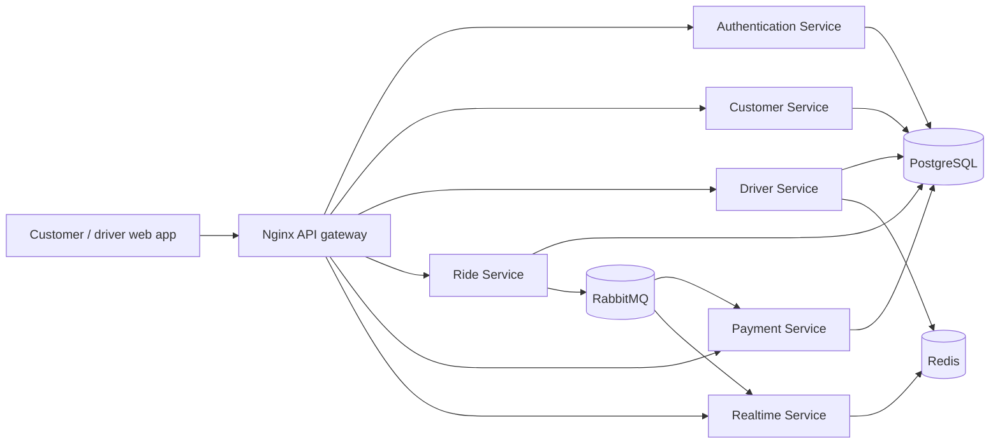

# Architecture

## Runtime layout

## Service ownership

| Service | Owns | Main responsibilities |
| --- | --- | --- |
| Authentication | `authentication_db` | Accounts, customer/driver roles, credentials, access tokens |
| Customer | `customer_db` | Customer-specific profile, saved places, preferences |
| Driver | `driver_db` | Driver and vehicle profiles; Redis holds live availability/location |
| Ride | `ride_db` | Ride lifecycle, status history, dispatch decisions, event outbox |
| Payment | `payment_db` | Simulated payment records and processing status |
| Realtime | No durable database | WebSocket connections and event fan-out |

PostgreSQL runs as one local container with a separate database per stateful service. Each service owns its migrations and tables. IDs that refer to another service are stored as external UUIDs; there are no cross-service foreign keys or direct cross-service database queries.

## Authorization

Authentication issues a signed token identifying the user and their `customer` or `driver` role. Each backend service validates the token and enforces the permissions for its own endpoints. Services also check resource ownership: a customer can access their own rides, and a driver can update only rides assigned to them. Nginx routes requests but does not replace these checks.

## Event flow

Ride Service records ride state and publishes domain events through RabbitMQ. `RideCompleted` is consumed by Payment Service for an idempotent simulated charge. Realtime Service consumes ride/payment events and sends updates over WebSockets. Driver location messages arrive over WebSocket and update short-lived driver state in Redis through Driver Service.

## Local network boundary

Only Nginx is exposed on the host at port 8080. Backend services and PostgreSQL/Redis/RabbitMQ communicate on the Compose network. RabbitMQ's management UI is bound to localhost for development.
