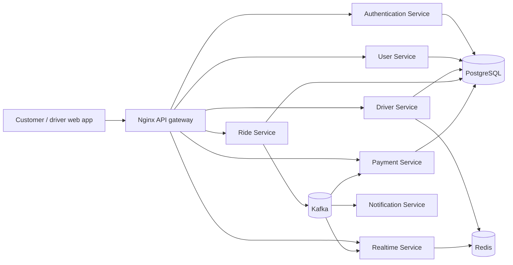

# Architecture

## Runtime layout

## Service ownership

| Service | Owns | Main responsibilities |
| --- | --- | --- |
| Authentication | `auth` schema | Accounts, credentials, customer/driver roles and tokens |
| User | `users` schema | Customer profile, saved places and preferences |
| Driver | `drivers` schema and Redis live state | Driver/vehicle profiles, availability and simulated location |
| Ride | `rides` schema | Ride lifecycle, dispatch decisions, status history and event outbox |
| Payment | `payments` schema | Simulated payment records and processing status |
| Realtime | No durable schema | WebSocket connections and event fan-out |
| Notification | No durable schema | Consumes domain events and prepares in-app/email notifications |

PostgreSQL runs as one local container with a schema per stateful service. Each service owns its migrations. IDs referencing another service are stored as external UUIDs; there are no cross-service foreign keys or direct cross-service database queries.

## Authorization

Authentication issues a signed token identifying the account and its `customer` or `driver` role. Each backend service validates the token and enforces permissions for its own endpoints. Services also check resource ownership. Nginx routes requests but does not replace service-level authorization.

## Event flow

Ride Service records ride state and writes domain events to its outbox. A publisher sends events such as `ride.completed` to Kafka. Payment Service processes a completed ride idempotently and publishes the payment result. Realtime and Notification Services consume relevant events; Realtime sends updates to connected clients over WebSockets.

## Local deployment

Docker Compose runs the backend services, PostgreSQL, Redis, a single-node Kafka broker in KRaft mode, the placeholder web container and Nginx. The Kafka configuration follows Apache Kafka's official single-node Docker example. This setup is for local development and evaluation, not a highly available broker cluster.
